  
   
  

<code>pablio@github ~ $ cat stack.md</code>

 

| Category | Technologies |
|---|---|
| **Languages** | TypeScript, JavaScript, Python, Java, SQL, HTML5, CSS3 |
| **Backend & APIs** | Node.js, Fastify, REST APIs, WebSocket, Postman |
| **AI & Automation** | Google Gemini API, Prompt Engineering, LLM QA, Chatbot Knowledge Base |
| **Databases** | PostgreSQL, Supabase, MySQL, Amazon DynamoDB (Single-Table) |
| **Cloud & DevOps** | AWS (S3, Lambda, API Gateway), Vercel, GitHub Actions, CI/CD, Git, Linux (Ubuntu) |
| **Frontend & UI** | React, Vite, Bootstrap 5, Leaflet Maps, Pixel Art, Responsive Web |
| **Methodologies & Quality** | Clean Code, Agile (Scrum/Kanban), Technical Documentation, Automated Testing |

 

  
  &nbsp;
  
  &nbsp;
  

